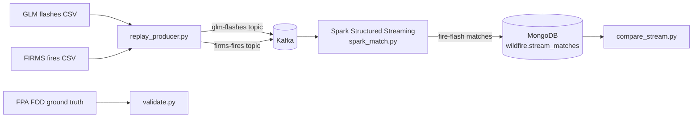

# Lightning-Caused Wildfire Detection Pipeline

A data pipeline that links satellite lightning observations to new wildfire detections, using the **August 2020 California lightning siege** as a case study.

- **Lightning:** NOAA GOES-17 Geostationary Lightning Mapper (GLM)
- **Fires:** NASA FIRMS VIIRS (S-NPP) active-fire detections
- **Ground truth:** USDA Forest Service FPA FOD, 6th edition (1992–2020)
- **Stack:** Kafka (KRaft) → Spark Structured Streaming → MongoDB, all in Docker Compose

**See [`results.ipynb`](results.ipynb) for charts and tables of every result below.**

---

## Status at a glance

| Component | Status | Main script(s) |
|---|---|---|
| Infrastructure (Kafka, MongoDB, Spark in Docker) | ✅ Done | `docker-compose.yml` |
| Data: GLM lightning, Aug 15–20, 2020 | ✅ Done | `get_glm.py` |
| Data: FIRMS fire detections, Aug 8–25, 2020 | ✅ Done | `get_firms.py` |
| Data: FPA FOD ground truth (CA, 2019–2020) | ✅ Done | `get_fpa_fod.py` |
| Matching prototype (pandas) | ✅ Done | `match_prototype.py` |
| Chance baseline + parameter tuning | ✅ Done | `baseline.py`, `tune.py` |
| Validation against FPA FOD | ✅ Done | `validate.py` |
| Precision/recall sweep against FPA FOD | ✅ Done | `pr_sweep.py` |
| Streaming pipeline (Kafka → Spark → MongoDB) | ✅ Done | `replay_producer.py`, `spark_match.py`, `compare_stream.py` |
| Throughput / latency benchmarks | ✅ Done | `bench.sh` |
| New-fire detection *inside* the stream | ⬜ To do | see [Remaining work](#remaining-work) |
| MongoDB geospatial query benchmarks | ✅ Done | `mongo_bench.py` |
| Snowflake load + MongoDB vs Snowflake comparison | ⬜ To do | — |
| Final report and slides | ⬜ To do | — |

---

## How the pipeline works



**Matching rule.** A fire detection is matched to lightning if a GLM flash occurred within **D km** and up to **T hours before** the detection. The tuned values are **D = 5 km, T = 48 h**.

**New-fire rule.** A detection counts as a *new* fire only if there was no other detection within **5 km** in the **previous 7 days**. This filters out fires that are already burning.

**Spark join.** Comparing every fire with every flash would be too slow, so `spark_match.py` buckets both streams into a spatial grid with cells about D km wide. Each flash is copied into its 3×3 neighbouring cells, and the stream-stream join only compares points that share a cell, within the 48-hour event-time window.

---

## Results so far

### Data

| Dataset | Window | Records |
|---|---|---|
| FIRMS VIIRS detections | Aug 8–25, 2020 | 44,022 (41,647 nominal/high confidence) |
| GLM flashes over California | Aug 15–20, 2020 | 60,803 (from 25,920 twenty-second files) |
| FPA FOD natural-cause fires, CA | 2019–2020 | 1,096 (271 discovered Aug 15–26, 2020) |

FIRMS detections jumped more than tenfold when the siege began: 2,718 for Aug 13–17, then 31,653 for Aug 18–22.

### Matching prototype (D = 5 km, T = 48 h, new-fire rule 5 km)

- 159 new fires since Aug 15; 139 fall inside the lightning data's coverage window.
- **65 of 139 (47%)** had at least one candidate flash.
- For matched fires, the median distance to the nearest flash was 1.8 km and the median lag was 20.1 h. That lag fits "holdover" fires that smoulder before a satellite sees them.

### Chance baseline and tuning

Our first baseline shuffled flash *times*. It was biased: lightning was concentrated on Aug 16–17, and shuffling spread it across all six days. We replaced it with a **spatial-shift baseline**, which keeps each flash's real time but moves the whole lightning field 50–100 km in a random direction.

| D (km) | T (h) | New-fire rule (km) | New fires | Real match rate | Chance rate | Ratio |
|---|---|---|---|---|---|---|
| **5** | **48** | **5** | **139** | **47%** | **31%** | **1.50** |
| 5 | 48 | 2 | 305 | 38% | 26% | 1.47 |
| 5 | 96 | 5 | 151 | 54% | 39% | 1.37 |
| 10 | 48 | 2 | 305 | 44% | 34% | 1.29 |
| 10 | 168 | 5 | 159 | 62% | 55% | 1.12 |

All 12 settings tested beat chance (full table in `tuning_results.csv`). A tighter distance, a 48-hour window and the stricter new-fire rule gave the cleanest signal.

### Validation against FPA FOD (Aug 15–22, 2020; 242 recorded lightning fires, 60 of them 10+ acres)

| | All new fires | Lightning-matched |
|---|---|---|
| Fires flagged | 139 | 65 |
| Precision | 23% | **38%** |
| Recall, all recorded fires | 19% | 16% |
| Recall, fires 10+ acres | 48% | 37% |
| F1 | 0.21 | 0.23 |

The lightning filter raised precision by about 1.7x, at some cost in recall. Overall recall is low mainly because 75% of recorded lightning fires were under 10 acres, which is below what VIIRS can reliably detect.

### Precision/recall trade-off against FPA FOD

We reran the matching and validation for D = 2, 5 and 10 km and T = 24, 48, 96 and 168 h (new-fire rule 5 km). Full results are in `pr_sweep.csv`.


| D (km) | T (h) | Fires flagged | Precision | Recall (all) | Recall (10+ acres) | F1 |
|---|---|---|---|---|---|---|
| 10 | 96 | 91 | 35% | 19% | 48% | 0.25 |
| 10 | 48 | 71 | 39% | 17% | 42% | 0.24 |
| **5** | **48** | **65** | **38%** | **16%** | **37%** | **0.23** |
| 5 | 168 | 84 | 33% | 17% | 42% | 0.23 |
| 5 | 24 | 39 | 38% | 12% | 20% | 0.18 |
| 2 | 48 | 35 | 34% | 7% | 17% | 0.11 |

Without the lightning filter, precision is 23%.

- **Every setting beats no filter** (33–40% precision vs 23%).
- **2 km is too tight.** Recall falls to 4–7%, consistent with GLM's ~8 km location accuracy.
- **48 h is the sweet spot.** Going from 24 h to 48 h raises recall without losing precision. Longer windows add little recall and lower precision, so most lightning fires were detected within two days.
- **5 km and 10 km are about tied.** The differences in F1 (0.23 vs 0.24–0.25) amount to a few fires out of 242. We keep **D = 5 km, T = 48 h** as the default, because it also scored best against the chance baseline (1.50x vs 1.29x for 10 km). D = 10 km is an equally good alternative.

### Streaming pipeline and benchmarks

The Spark streaming job matched **the same 65 new fires as the pandas prototype (100% agreement)** at every replay speed.

| Replay speed | Events | Replay time (s) | Producer (events/s) | Spark peak (events/s) | Agreement | Latency median / p95 (s) |
|---|---|---|---|---|---|---|
| 3,600x | 92,594 | 188.8 | 490 | 14,734 | 100% | 3.6 / 4.0 |
| 36,000x | 92,594 | 18.9 | 4,887 | 24,882 | 100% | 3.3 / 4.7 |
| max | 92,594 | 6.1 | 15,215 | 28,809 | 100% | 6.7 / 7.3 |

Latency is bounded mainly by Spark's 5-second micro-batch trigger. Throughput was limited by the Python producer, not by Spark.

### MongoDB geospatial queries

For each of the 139 new fires, we asked MongoDB for "GLM flashes within 5 km and the 48 h before this fire" (`$geoWithin` + time range) over 60,803 flashes, with three index setups:

| Index | Build time (s) | Median query (ms) | p95 query (ms) | Docs examined per query | Fires matched |
|---|---|---|---|---|---|
| None (full scan) | 0 | 36.64 | 41.03 | 60,803 | 65 |
| 2dsphere on location | 0.17 | 0.57 | 0.72 | 10 | 65 |
| 2dsphere + flash_time | 0.17 | 0.56 | 0.70 | 6 | 65 |

The 2dsphere index made queries about 64x faster and cut the documents examined from 60,803 to 10 per query. Adding time to the index reduced that to 6, but at this data size the speed is about the same. All three setups matched the same 65 fires as the pandas prototype and the Spark stream. Loading the flashes took 0.4 s.

---

## Setup

Requires Docker Desktop and Python 3.

```bash
pip install -r requirements.txt
docker compose up -d                  # starts kafka, mongodb, spark
docker compose ps                     # all three should be "Up"
for t in glm-flashes firms-fires; do
  docker exec kafka /opt/kafka/bin/kafka-topics.sh --bootstrap-server localhost:9092 \
    --create --if-not-exists --topic $t --partitions 3 --replication-factor 1
done
```

**Mac with Python from python.org:** if downloads fail with an SSL error, run `"/Applications/Python 3.14/Install Certificates.command"` once.

## Reproducing the results

The processed data files (`firms_aug2020.csv`, `glm_aug2020.csv`, `fpa_fod_ca_lightning.csv`) are in the repo, so **you can start at step 4**. Steps 1–3 are only needed to re-download the data.

| Step | Command | Time | Output |
|---|---|---|---|
| 1. Fire data | `python get_firms.py YOUR_MAP_KEY` (free key: [FIRMS API](https://firms.modaps.eosdis.nasa.gov/api/map_key/)) | ~1 min | `firms_aug2020.csv` |
| 2. Lightning data | `for d in 228 229 230 231 232 233; do python get_glm.py --day $d --hours {0..23} --out glm_day$d.csv; done`, then combine the `glm_day*.csv` files into `glm_aug2020.csv` | ~1.5 h | `glm_aug2020.csv` |
| 3. Ground truth | Download the SQLite version of [FPA FOD](https://www.fs.usda.gov/rds/archive/catalog/RDS-2013-0009.6), unzip, then `python get_fpa_fod.py PATH.sqlite` | ~5 min | `fpa_fod_ca_lightning.csv` |
| 4. Matching | `python match_prototype.py --d-km 5 --t-hours 48 --new-km 5` | seconds | `new_fires.csv`, `fire_flash_matches.csv` |
| 5. Tuning | `python tune.py` | ~10 min | `tuning_results.csv` |
| 6. Validation | `python validate.py` | seconds | `validation_fires.csv` |
| 6b. Precision/recall sweep | `python pr_sweep.py` | ~1 min | `pr_sweep.csv`, `pr_tradeoff.png` |
| 7. Streaming benchmarks | `bash bench.sh` (needs Docker running) | ~12 min | `benchmark_results.csv` |
| 7b. MongoDB queries | `docker compose up -d mongodb`, then `python mongo_bench.py` | ~1 min | `mongo_benchmark.csv` |
| 8. Results notebook | `jupyter notebook results.ipynb` → Run All | ~1 min | charts and tables |

`tune.py` reruns the matching many times and **overwrites** `new_fires.csv` / `fire_flash_matches.csv`. Rerun step 4 afterwards, before steps 6 and 7.

**Running one streaming run by hand** (instead of `bench.sh`): start Spark first and wait for "Streaming started", then start the producer in a second terminal:

```bash
docker exec spark /opt/spark/bin/spark-submit \
  --packages org.apache.spark:spark-sql-kafka-0-10_2.12:3.5.3,org.mongodb.spark:mongo-spark-connector_2.12:10.4.0 \
  --conf spark.jars.ivy=/tmp/.ivy2 spark_match.py --run-seconds 420
python replay_producer.py --speed 3600        # in a second terminal
python compare_stream.py                      # after Spark finishes
```

---

## Remaining work

1. **Detect new fires inside the stream**. Today Spark matches *every* fire detection to lightning, and the "new fire" filter is applied afterwards in batch (`compare_stream.py`). Moving it into the stream is the main remaining engineering task. Options from our proposal: a geohash/H3 grid cell plus date key kept in Spark state, a time-bucketed Bloom filter, or a MongoDB `$near` lookup inside `foreachBatch`. Test with `compare_stream.py`: the result should still be 65 new fires.
2. ~~MongoDB geospatial queries~~ ✅ Done (`mongo_bench.py`, results above). These query times are the baseline for the Snowflake comparison.
3. **Snowflake comparison**. Load the same CSVs into Snowflake, run the equivalent spatial-temporal query (e.g. `ST_DWITHIN`), and compare query time and cost with MongoDB (see `mongo_benchmark.csv`).
4. **Kafka producers**. `replay_producer.py` replays our CSVs. Optional extensions: a producer that reads GLM files straight from S3, and replay at true 1x speed for a short window.
5. **Broader evaluation** (all). Extend beyond Aug 15–22, add NIFC fire perimeters as a second ground truth, and check famous fires (August, LNU, SCU, CZU complexes) in `validation_fires.csv`.
6. **Final report and slides** (all), due Nov 17.

## Known limitations

- GLM's location accuracy is about 8 km, so distances under a few km between a fire and a flash aren't meaningful.
- VIIRS passes over about twice a day, which adds up to ~12 h of delay between ignition and detection.
- FPA FOD records each fire's point of origin, and complexes are sometimes a single record, so some correct detections are more than 5 km from the recorded point. Precision may be understated.
- The latency figures assume the clocks on the host machine and inside Docker are in sync.

## AI use

We used Claude (Anthropic) as a coding and writing assistant: for the Docker configuration, the download, matching and streaming scripts, troubleshooting, and report drafting. We ran every script ourselves, and all numbers come from our own runs.
