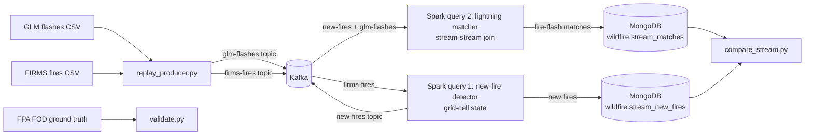
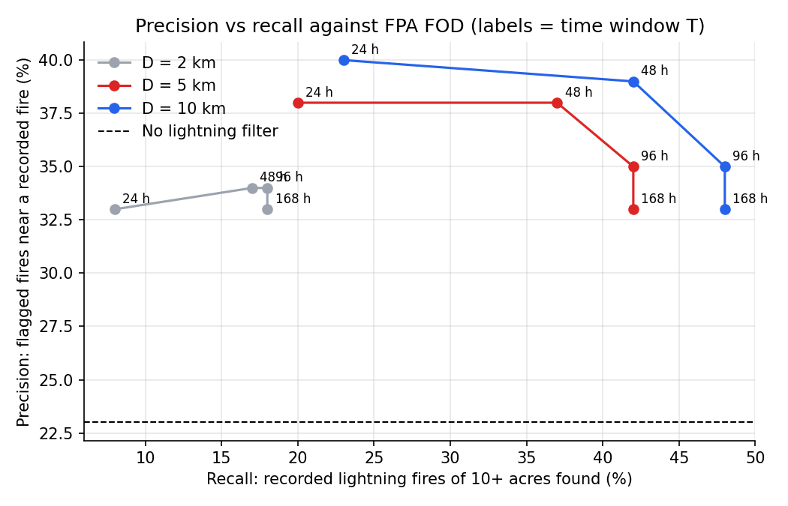

# Lightning-Caused Wildfire Detection Pipeline

A data pipeline that links satellite lightning observations to new wildfire detections, using the **August 2020 California lightning siege** as a case study.

- **Lightning:** NOAA GOES-17 Geostationary Lightning Mapper (GLM)
- **Fires:** NASA FIRMS VIIRS (S-NPP) active-fire detections
- **Ground truth:** USDA Forest Service FPA FOD, 6th edition (1992–2020), and CAL FIRE fire perimeters (2020)
- **Stack:** Kafka (KRaft) → Spark Structured Streaming → MongoDB, all in Docker Compose; Snowflake for the warehouse comparison
- **Project board:** [Trello](https://trello.com/b/LEu9Qd2D/wildfire-lightning-pipeline-data-228)

**See [`results.ipynb`](results.ipynb) for charts and tables of every result below.**

---

## Status at a glance

| Component | Status | Main script(s) |
|---|---|---|
| Infrastructure (Kafka, MongoDB, Spark in Docker) | ✅ Done | `docker-compose.yml` |
| Data: GLM lightning, Aug 15–25, 2020 | ✅ Done | `get_glm.py` |
| Data: FIRMS fire detections, Aug 8–25, 2020 | ✅ Done | `get_firms.py` |
| Data: FPA FOD ground truth (CA, 2019–2020) | ✅ Done | `get_fpa_fod.py` |
| Data: CAL FIRE fire perimeters (CA, 2020) | ✅ Done | `get_nifc.py` |
| Matching prototype (pandas) | ✅ Done | `match_prototype.py` |
| Chance baseline + parameter tuning | ✅ Done | `baseline.py`, `tune.py` |
| Validation against FPA FOD | ✅ Done | `validate.py` |
| Precision/recall sweep against FPA FOD | ✅ Done | `pr_sweep.py` |
| Streaming pipeline (Kafka → Spark → MongoDB) | ✅ Done | `replay_producer.py`, `spark_match.py`, `compare_stream.py` |
| Throughput / latency benchmarks | ✅ Done | `bench.sh` |
| New-fire detection *inside* the stream | ✅ Done | `new_fire_state.py`, `spark_match.py`, `test_new_fire_state.py` |
| MongoDB geospatial query benchmarks | ✅ Done | `mongo_bench.py` |
| Snowflake load + MongoDB vs Snowflake comparison | ✅ Done | `snowflake_queries.sql` |
| Course techniques (Bloom filter, Flajolet–Martin, LSH, differential privacy, data poisoning) | ✅ Done | `course_techniques.py` |
| Broader evaluation (Aug 15–25, fire perimeters, famous complexes) | ✅ Done | `broad_eval.py`, `get_nifc.py` |
| Final report and slides | 🟡 Drafted; team details and final edits in progress | — |

---

## How the pipeline works



**Matching rule.** A fire detection is matched to lightning if a GLM flash occurred within **D km** and up to **T hours before** the detection. The tuned values are **D = 5 km, T = 48 h**.

**New-fire rule.** A detection counts as a *new* fire only if there was no other detection within **5 km** in the **previous 7 days**. This filters out fires that are already burning.

**In-stream new-fire detection.** Spark query 1 (`spark_match.py`, logic in `new_fire_state.py`) applies the new-fire rule to the live `firms-fires` stream. It splits the map into grid cells at least 5 km wide and copies each detection into its 3×3 block of cells. Each cell keeps the last 7 days of detections in Spark state (`applyInPandasWithState`, saved in the checkpoint). A detection is checked in its own cell against that state, and it is new if nothing in the state is within 5 km and earlier. New fires are published to a `new-fires` Kafka topic, and query 2 matches only those to lightning. Running two queries avoids Spark's limits on chaining a custom stateful operator into a stream-stream join, and other consumers can also read the `new-fires` topic.

**Spark join.** Comparing every fire with every flash would be too slow, so `spark_match.py` buckets both streams into a spatial grid with cells about D km wide. Each flash is copied into its 3×3 neighbouring cells, and the stream-stream join only compares points that share a cell, within the 48-hour event-time window.

---

## Results

### Data

| Dataset | Window | Records |
|---|---|---|
| FIRMS VIIRS detections | Aug 8–25, 2020 | 44,022 (41,647 nominal/high confidence) |
| GLM flashes over California | Aug 15–20, 2020 | 60,803 (from 25,920 twenty-second files) |
| GLM flashes over California (extension) | Aug 21–25, 2020 | 36,948 (822 / 1,825 / 6,910 / 12,405 / 14,986 per day) |
| FPA FOD natural-cause fires, CA | 2019–2020 | 1,096 (271 discovered Aug 15–26, 2020) |
| CAL FIRE fire perimeters, CA | 2020 | 503 (51 lightning fires that started Aug 13–27, 18 of them 1,000+ acres) |

FIRMS detections jumped more than tenfold when the siege began: 2,718 for Aug 13–17, then 31,653 for Aug 18–22.

### Matching prototype (D = 5 km, T = 48 h, new-fire rule 5 km)

- 159 new fires since Aug 15; 139 fall inside the lightning data's coverage window.
- **65 of 139 (47%)** had at least one candidate flash.
- For matched fires, the median distance to the nearest flash was 1.8 km and the median lag was 20.1 h. That lag fits "holdover" fires that smoulder before a satellite sees them.

### Chance baseline and tuning

Our first baseline shuffled flash *times*. It was biased: lightning was concentrated on Aug 16–17, and shuffling spread it across all six days. We replaced it with a **spatial-shift baseline**, which keeps each flash's real time but moves the whole lightning field 50–100 km in a random direction.

| D (km) | T (h) | New-fire rule (km) | New fires | Real match rate | Chance rate | Ratio |
|---|---|---|---|---|---|---|
| **5** | **48** | **5** | **139** | **47%** | **31%** | **1.50** |
| 5 | 48 | 2 | 305 | 38% | 26% | 1.47 |
| 5 | 96 | 5 | 151 | 54% | 39% | 1.37 |
| 10 | 48 | 2 | 305 | 44% | 34% | 1.29 |
| 10 | 168 | 5 | 159 | 62% | 55% | 1.12 |

All 12 settings tested beat chance (full table in `tuning_results.csv`). A tighter distance, a 48-hour window and the stricter new-fire rule gave the cleanest signal.

### Validation against FPA FOD (Aug 15–22, 2020; 242 recorded lightning fires, 60 of them 10+ acres)

| | All new fires | Lightning-matched |
|---|---|---|
| Fires flagged | 139 | 65 |
| Precision | 23% | **38%** |
| Recall, all recorded fires | 19% | 16% |
| Recall, fires 10+ acres | 48% | 37% |
| F1 | 0.21 | 0.23 |

The lightning filter raised precision by about 1.7x, at some cost in recall. Overall recall is low mainly because 75% of recorded lightning fires were under 10 acres, which is below what VIIRS can reliably detect.

### Precision/recall trade-off against FPA FOD

We reran the matching and validation for D = 2, 5 and 10 km and T = 24, 48, 96 and 168 h (new-fire rule 5 km). Full results are in `pr_sweep.csv`.



| D (km) | T (h) | Fires flagged | Precision | Recall (all) | Recall (10+ acres) | F1 |
|---|---|---|---|---|---|---|
| 10 | 96 | 91 | 35% | 19% | 48% | 0.25 |
| 10 | 48 | 71 | 39% | 17% | 42% | 0.24 |
| **5** | **48** | **65** | **38%** | **16%** | **37%** | **0.23** |
| 5 | 168 | 84 | 33% | 17% | 42% | 0.23 |
| 5 | 24 | 39 | 38% | 12% | 20% | 0.18 |
| 2 | 48 | 35 | 34% | 7% | 17% | 0.11 |

Without the lightning filter, precision is 23%.

- **Every setting beats no filter** (33–40% precision vs 23%).
- **2 km is too tight.** Recall falls to 4–7%, consistent with GLM's ~8 km location accuracy.
- **48 h is the sweet spot.** Going from 24 h to 48 h raises recall without losing precision. Longer windows add little recall and lower precision, so most lightning fires were detected within two days.
- **5 km and 10 km are about tied.** The differences in F1 (0.23 vs 0.24–0.25) amount to a few fires out of 242. We keep **D = 5 km, T = 48 h** as the default, because it also scored best against the chance baseline (1.50x vs 1.29x for 10 km). D = 10 km is an equally good alternative.

### Largest recorded lightning fires

`named_fires.py` checks the 15 largest FPA FOD lightning fires discovered Aug 15–22, 2020 (same 5 km / 2 day rule as `validate.py`). Full table in `named_fires.csv`.

| Fire | Complex | Discovered | Acres | Seen as new fire | Lightning-matched |
|---|---|---|---|---|---|
| Doe | August | Aug 16 | 589,368 | yes | yes |
| Hopkins | August | Aug 17 | 328,363 | yes | no |
| Claremont | North | Aug 17 | 318,776 | yes | no |
| Hennessey | LNU Lightning | Aug 17 | 305,651 | yes | yes |
| Castle | SQF | Aug 19 | 174,178 | no | no |
| W-5 Cold Springs | | Aug 18 | 84,817 | yes | yes |
| Wallbridge | LNU Lightning | Aug 17 | 55,209 | yes | yes |
| SHF Elkhorn | August | Aug 18 | 51,577 | yes | yes |
| Dome | | Aug 15 | 43,273 | yes | no |
| Sheep | North | Aug 17 | 29,570 | yes | yes |
| Glade | August | Aug 19 | 26,197 | yes | no |
| Tatham | August | Aug 16 | 14,457 | no | no |
| Hull | August | Aug 19 | 12,284 | yes | yes |
| Bear | North | Aug 17 | 12,154 | yes | yes |
| Rattlesnake | | Aug 16 | 8,419 | no | no |

12 of the 15 largest fires were seen as new fires, and 8 were matched to lightning. Those 8 cover 1.14 million of the 2.05 million acres (56%).

### Broader evaluation (Aug 15–25)

`broad_eval.py` extends the validation to every day the FIRMS data covers, and checks the famous lightning complexes. It uses the same rules as the rest of the project and does its own matching, so it doesn't overwrite `new_fires.csv` or `fire_flash_matches.csv`. GLM lightning now covers Aug 15–25: `glm_aug2020.csv` plus `glm_day234.csv`–`glm_day238.csv` (Aug 21–25, 36,948 more flashes). Results are in `broad_eval_summary.csv`, `broad_eval_by_day.csv` and `famous_fires.csv`.

**Longer window, against FPA FOD.** The original-window column reproduces `validate.py` exactly.

| | Aug 15–22 (original) | Aug 15–25 (extended) | Aug 23–25 only |
|---|---|---|---|
| FPA FOD lightning fires (10+ acres) | 242 (60) | 268 (65) | 26 (5) |
| New fires flagged | 139 | 159 | 20 |
| Lightning-matched | 65 | 70 | 5 |
| Precision, all new fires / lightning-matched | 23% / 38% | 22% / 39% | 15% / 40% |
| Recall, all new fires / lightning-matched | 19% / 16% | 18% / 15% | 12% / 8% |
| Recall for 10+ acre fires, all / lightning-matched | 48% / 37% | 48% / 37% | 40% / 40% |
| F1, all / lightning-matched | 0.21 / 0.23 | 0.20 / 0.22 | 0.13 / 0.13 |

- **The results hold over the longer window.** With the lightning filter, precision stays at 38–40% against 22–23% without it, and recall for 10+ acre fires is 37% in both windows.
- **The original window didn't change.** The new GLM data adds no matches for Aug 15–22, so earlier results (`validate.py`, `pr_sweep.py`, the stream) stand.
- **A second lightning episode on Aug 23–25.** GLM recorded 6,910–14,986 flashes a day over California on Aug 23–25, after a quiet Aug 21–22 (822 and 1,825). FPA FOD has 25 lightning fires discovered on Aug 24–25. The pipeline matched 5 new fires to lightning on those days, 2 of them within 5 km and 2 days of a recorded fire.
- **The match rate is lower on the new days:** 5 of 20 new fires (25%), against 65 of 139 (47%) for Aug 15–22. One possible reason: large siege fires were still spreading then, so more of the "new" detections may be new parts of existing fires rather than new ignitions.

**Famous complexes, against FPA FOD.**

| Complex | FPA FOD records | Recorded acres | Seen as new fire | Lightning-matched | Acres of lightning-matched records |
|---|---|---|---|---|---|
| August | 39 | 1,031,895 | 23 | 21 | 662,091 (64%) |
| LNU Lightning | 5 | 366,843 | 4 | 3 | 361,671 (99%) |
| SCU Lightning | 0 | — | — | — | — |
| CZU Lightning | 0 | — | — | — | — |

FPA FOD has **no records for the SCU or CZU complexes**, even though they were two of the largest fires of the siege. The few FPA FOD points in those areas are small, unnamed state fires. Checking those two complexes needs fire perimeters (below).

**Perimeters (second ground truth).** The NIFC "InterAgencyFirePerimeterHistory" layer returned only 12 small 2020 California perimeters and none of the siege complexes, so `get_nifc.py` downloads CAL FIRE's "California Fire Perimeters (all)" instead (`fire_perimeters_ca2020.geojson`, 503 perimeters for 2020). Each perimeter records its cause (1 = lightning) and alarm date. A pipeline fire counts if it lies inside a perimeter or within 1 km of its edge (`--buffer-km`). Recall is measured on the 18 lightning fires of 1,000+ acres that started Aug 13–27. Full table in `perimeter_results.csv`.

| Aug 15–25 | All new fires | Lightning-matched |
|---|---|---|
| Fires flagged | 159 | 70 |
| Inside any 2020 perimeter | 53% | 77% |
| Inside a lightning-fire perimeter (precision) | 46% | 76% |
| Large lightning fires detected (of 18) | 16 (89%) | 14 (78%) |
| Share of those fires' acres detected | 100% | 96% |

- **The lightning filter works against this ground truth too.** Precision rises from 46% to 76%, the same ~1.7x gain as against FPA FOD. Precision is higher here because a detection anywhere on a fire counts, not just near its recorded point of origin.
- **Missed large fires:** Rattlesnake (8,309 acres) and Moraine (1,301 acres) were never flagged as new fires.
- **Famous complexes.** All four were detected and matched to lightning within one to two days of the Aug 16–17 storms: August (16 new fires inside, 13 matched, first on Aug 17 09:17), SCU (9 / 7, Aug 16 20:58), CZU (4 / 3, Aug 16 20:58), and LNU (Hennessey 12 / 7, Walbridge 2 / 2, Meyers 1 / 1, Aug 18). Perimeters are the only ground truth for SCU and CZU.
- **Caveat.** A perimeter shows a fire's final extent, so a detection inside one may be a new spot on an already-burning fire rather than a separate ignition.

### Streaming pipeline and benchmarks

With new-fire detection running inside the stream, Spark **detected the same 139 new fires as the pandas prototype and matched the same 65 to lightning (100% agreement on both)** at every replay speed.

| Replay speed | Events | Replay time (s) | Producer (events/s) | Spark peak (events/s) | New fires detected | New-fire agreement | Matched new fires | Match agreement | Detection latency median (s) | End-to-end latency median / p95 (s) |
|---|---|---|---|---|---|---|---|---|---|---|
| 3,600x | 92,594 | 188.8 | 490 | 16,405 | 139 | 100% | 65 | 100% | 3.7 | 7.5 / 9.4 |
| 36,000x | 92,594 | 19.0 | 4,880 | 25,669 | 139 | 100% | 65 | 100% | 3.8 | 7.5 / 9.2 |
| max | 92,594 | 2.7 | 34,453 | 30,959 | 139 | 100% | 65 | 100% | 5.3 | 7.1 / 7.6 |

- **Latency.** End-to-end latency rose from 3.3–6.7 s (median) before the change to 7.1–7.5 s. Each fire now passes through two 5-second micro-batch steps: the detector, then the matcher. The detector step alone takes a median of 3.7–5.3 s.
- **Spark peak** is the matcher's rate. It now sees 60,942 events (60,803 flashes plus 139 new fires) instead of every raw detection, so it can't be compared directly with the earlier figures. The detector handled all 32,992 detections (1,201 of them warm-up) at a peak of 3,110–7,653 detections/s.
- **Throughput** is still limited by the Python producer, not by Spark.

### New-fire detection inside the stream

Spark used to match *every* detection to lightning, and `compare_stream.py` then dropped the ones that weren't new fires. Spark now runs the new-fire rule itself, as part of the stream:

- **Warm-up.** The rule looks 7 days back, so `replay_producer.py` first sends the 1,201 detections from Aug 8–14 as fast as it can. These only fill the state and are never reported as fires. The timed replay is unchanged at 92,594 events.
- **Order.** Pixels from one satellite overpass share a timestamp. The prototype counts the first one in its sort order as the new fire, so every fire message carries `seq`, its position in the prototype's order. Fire messages also share one Kafka key, so they land in one partition and Spark reads them in order.
- **State size.** The busiest cell held 1,835 detections. State older than 7 days is dropped.

**Offline check (`test_new_fire_state.py`).** This script sends the producer's output through the same state function Spark uses, without Spark. It splits the stream into 1, 50, 200 or 5,000 micro-batches and shuffles the rows inside each batch. In every case it finds **the same 139 new fires as the prototype** (all of the prototype's new fires up to Aug 22; its other 20 come after the replay ends). Those fires give **the same 65 lightning matches**.

**In Docker (`bench.sh`).** The Spark run confirmed this at all three replay speeds: 139 of 139 new fires and 65 of 65 matches. See the benchmark table under [Streaming pipeline and benchmarks](#streaming-pipeline-and-benchmarks).

### MongoDB and Snowflake geospatial queries

For each of the 139 new fires, we asked MongoDB for "GLM flashes within 5 km and the 48 h before this fire" (`$geoWithin` + time range) over 60,803 flashes, with three index setups:

| Index | Build time (s) | Median query (ms) | p95 query (ms) | Docs examined per query | Fires matched |
|---|---|---|---|---|---|
| None (full scan) | 0 | 36.64 | 41.03 | 60,803 | 65 |
| 2dsphere on location | 0.17 | 0.57 | 0.72 | 10 | 65 |
| 2dsphere + flash_time | 0.17 | 0.56 | 0.70 | 6 | 65 |

The 2dsphere index made queries about 64x faster and cut the documents examined from 60,803 to 10 per query. Adding time to the index reduced that to 6, but at this data size the speed is about the same. All three setups matched the same 65 fires as the pandas prototype and the Spark stream. Loading the flashes took 0.4 s.

**Snowflake** (`snowflake_queries.sql`, `snowflake_benchmark.csv`; X-Small warehouse, result cache off). The same rule with `ST_DWITHIN` (5,000 m) and a 48 h window matched the same 65 fires. One join over all new fires took 521 ms median (120 ms of execution); a single-fire lookup took 346 ms (107 ms of execution), about 600x slower than an indexed MongoDB lookup. The warehouse suits batch analysis; MongoDB suits per-event lookups inside the stream.

### Course techniques

`course_techniques.py` applies five course techniques to the same data. Full output in `course_techniques_output.txt`; tables in `results_bloom.csv`, `results_fm.csv`, `results_lsh.csv`, `results_dp.csv`, `results_poison.csv`. These run as a time-ordered pass that simulates a stream, not inside Spark.

| Technique | Result |
|---|---|
| Bloom filter (new-fire rule) | 10.2 KB vs 362.3 KB for an exact set (36x smaller), all 139 new fires found at a 0.01% target false-positive rate; at 1% it missed 14, because each event does 200 lookups |
| Flajolet–Martin (distinct 1 km cells struck per day) | 8.8% mean error |
| p-stable LSH (fire–flash candidates) | k = 2, L = 4: 107 candidates per fire (0.18% of flashes), 100% fire recall, 96.4% pair recall |
| Laplace differential privacy (released counts) | ε = 1: 9.9% error per day, 29% per cell; ε = 0.1: 81% / 209% |
| Data poisoning (fake flashes) | Precision falls from 38.5% to 27.0% at 100% poison with a ≥1-flash rule, but stays at 34.4% with a ≥3-flash rule (38.8% clean) |

---

## Setup

Requires Docker Desktop and Python 3.

```bash
pip install -r requirements.txt
docker compose up -d                  # starts kafka, mongodb, spark
docker compose ps                     # all three should be "Up"
docker exec spark pip3 install "numpy<2" "pandas<2.3" "pyarrow<15"   # for the new-fire detector (once per container)
for t in glm-flashes firms-fires new-fires; do
  docker exec kafka /opt/kafka/bin/kafka-topics.sh --bootstrap-server localhost:9092 \
    --create --if-not-exists --topic $t --partitions 3 --replication-factor 1
done
```

**Mac with Python from python.org:** if downloads fail with an SSL error, run `"/Applications/Python 3.14/Install Certificates.command"` once.

## Reproducing the results

The processed data files (`firms_aug2020.csv`, `glm_aug2020.csv`, `fpa_fod_ca_lightning.csv`) are in the repo, so **you can start at step 4**. Steps 1–3 are only needed to re-download the data.

| Step | Command | Time | Output |
|---|---|---|---|
| 1. Fire data | `python get_firms.py YOUR_MAP_KEY` (free key: [FIRMS API](https://firms.modaps.eosdis.nasa.gov/api/map_key/)) | ~1 min | `firms_aug2020.csv` |
| 2. Lightning data | `for d in 228 229 230 231 232 233; do python get_glm.py --day $d --hours {0..23} --out glm_day$d.csv; done`, then combine the `glm_day*.csv` files into `glm_aug2020.csv` | ~1.5 h | `glm_aug2020.csv` |
| 3. Ground truth | Download the SQLite version of [FPA FOD](https://www.fs.usda.gov/rds/archive/catalog/RDS-2013-0009.6), unzip, then `python get_fpa_fod.py PATH.sqlite` | ~5 min | `fpa_fod_ca_lightning.csv` |
| 4. Matching | `python match_prototype.py --d-km 5 --t-hours 48 --new-km 5` | seconds | `new_fires.csv`, `fire_flash_matches.csv` |
| 4b. New-fire detector check | `python replay_producer.py --to-dir stream_in --speed 0`, then `python test_new_fire_state.py` | ~1 min | prints PASS/FAIL |
| 5. Tuning | `python tune.py` | ~10 min | `tuning_results.csv` |
| 6. Validation | `python validate.py` | seconds | `validation_fires.csv` |
| 6c. Largest-fire check | `python named_fires.py` | seconds | `named_fires.csv` |
| 6d. Broader evaluation | First `for d in 234 235 236 237 238; do python get_glm.py --day $d --hours {0..23} --out glm_day$d.csv; done` (~1 h) and `python get_nifc.py`, then `python broad_eval.py` | seconds | `broad_eval_summary.csv`, `broad_eval_by_day.csv`, `famous_fires.csv`, `perimeter_results.csv` |
| 6b. Precision/recall sweep | `python pr_sweep.py` | ~1 min | `pr_sweep.csv`, `pr_tradeoff.png` |
| 7. Streaming benchmarks | `bash bench.sh` (needs Docker running) | ~12 min | `benchmark_results.csv` |
| 7b. MongoDB queries | `docker compose up -d mongodb`, then `python mongo_bench.py` | ~1 min | `mongo_benchmark.csv` |
| 7c. Snowflake comparison | Load `glm_aug2020.csv` into table `GLM` and `new_fires.csv` into table `NEW_FIRES` (see the comment at the top of the file), then run `snowflake_queries.sql` in a Snowflake worksheet | ~5 min | `snowflake_benchmark.csv` |
| 7d. Course techniques | `python course_techniques.py > course_techniques_output.txt` | ~2 min | `results_*.csv`, `course_techniques_output.txt` |
| 8. Results notebook | `jupyter notebook results.ipynb` → Run All | ~1 min | charts and tables |

`tune.py` reruns the matching many times and **overwrites** `new_fires.csv` / `fire_flash_matches.csv`. Rerun step 4 afterwards, before steps 6 and 7.

**Running one streaming run by hand** (instead of `bench.sh`): start Spark first and wait for "Streaming started", then start the producer in a second terminal:

```bash
docker exec spark /opt/spark/bin/spark-submit \
  --packages org.apache.spark:spark-sql-kafka-0-10_2.12:3.5.3,org.mongodb.spark:mongo-spark-connector_2.12:10.4.0 \
  --conf spark.jars.ivy=/tmp/.ivy2 spark_match.py --run-seconds 420
python replay_producer.py --speed 3600        # in a second terminal
python compare_stream.py                      # after Spark finishes
```

Add `--match-all` to the `spark-submit` command to get the old behaviour (match every detection, then filter in `compare_stream.py`). Before rerunning by hand, drop `wildfire.stream_matches` and `wildfire.stream_new_fires` and delete `/tmp/spark_chk` in the Spark container (`bench.sh` does this for you).

---

## Remaining work

1. ~~**Detect new fires inside the stream**~~ ✅ Done. Built with the grid-cell-in-Spark-state option from our proposal (see [New-fire detection inside the stream](#new-fire-detection-inside-the-stream)). It matches the prototype exactly at every replay speed (139 new fires, 65 matched). End-to-end latency is 7.1–7.5 s (median).
2. ~~MongoDB geospatial queries~~ ✅ Done (`mongo_bench.py`, results above). These query times are the baseline for the Snowflake comparison.
3. ~~**Snowflake comparison**~~ ✅ Done (`snowflake_queries.sql`, `snowflake_benchmark.csv`). `ST_DWITHIN` on an X-Small warehouse matched the same 65 fires; one join over all fires took 521 ms (median) vs 0.08 s for MongoDB's indexed per-fire queries and 4.67 s without an index. A single-fire lookup took 346 ms vs 0.57 ms in MongoDB.
4. ~~**Kafka producers**~~ ✅ Done. `replay_producer.py` replays our CSVs into the `glm-flashes` and `firms-fires` topics (3 partitions each); reproduced and benchmarked at 3,600x, 36,000x and max speed with 100% agreement.
5. ~~**Broader evaluation**~~ ✅ Done. `broad_eval.py` covers Aug 15–25 against FPA FOD and CAL FIRE perimeters and checks the August, LNU, SCU and CZU complexes (see [Broader evaluation](#broader-evaluation-aug-1525)).
6. ~~**Course techniques**~~ ✅ Done (`course_techniques.py`).
7. 🟡 **Final report and slides** (all). Drafted with every result above; team names, CRediT roles and final edits in progress.

### Possible next steps

- Replace the detector's exact per-cell state with the Bloom filter, so memory stays fixed as the stream grows.
- Spread fire messages over several Kafka partitions without losing the order the new-fire rule depends on.
- Extend to the full 2020 season and test a proximity index instead of a fixed D and T.

## Known limitations

- GLM's location accuracy is about 8 km, so distances under a few km between a fire and a flash aren't meaningful.
- VIIRS passes over about twice a day, which adds up to ~12 h of delay between ignition and detection.
- FPA FOD records each fire's point of origin, and complexes are sometimes a single record, so some correct detections are more than 5 km from the recorded point. Precision may be understated.
- Which pixel of an overpass counts as the "new fire" depends on how ties are broken. The prototype uses pandas' default (unstable) sort. With a stable sort it would find 159 / 140 / **66** instead of 159 / 139 / 65. The fire *clusters* are the same, but a different pixel can sit just inside or outside the 5 km flash radius. The stream copies the prototype's order (`seq`) so the two can be compared exactly.
- All fire messages share one Kafka key, so they go to a single partition. This keeps them in order but limits parallelism.
- The latency figures assume the clocks on the host machine and inside Docker are in sync.

## AI use

We used Claude (Anthropic) as a coding and writing assistant: for the Docker configuration, the download, matching and streaming scripts, troubleshooting, and report drafting. We ran every script ourselves, and all numbers come from our own runs.
